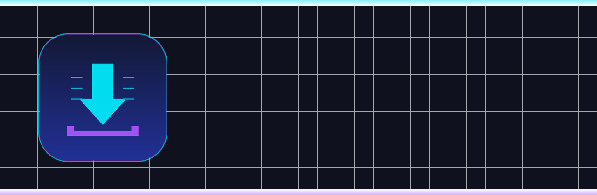
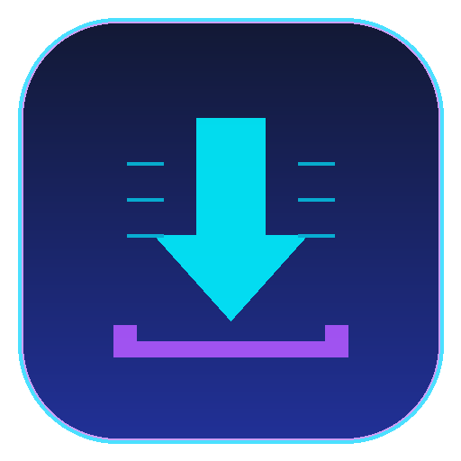
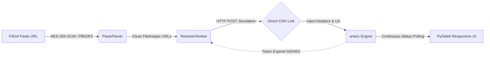

<p align="center">
  
</p>

<h1 align="center">⚡ FileKeeper Batch Downloader for FitGirl Repacks</h1>

<p align="center">
  <strong>The ultimate autonomous, headless, multi-threaded batch downloader & link resolver for FileKeeper hosting on FitGirl-Repacks.site</strong>
</p>

<p align="center">
  <a href="https://github.com/codes-of-santhosh/filekeeper-downloader-for-fitgirl/releases"></a>
  <a href="https://www.python.org/"></a>
  <a href="https://www.qt.io/"></a>
  <a href="https://aria2.github.io/"></a>
  <a href="LICENSE"></a>
</p>

<p align="center">
  <a href="#-quick-download--installer"><b>🚀 Quick Download</b></a> •
  <a href="#-key-features"><b>✨ Features</b></a> •
  <a href="#-why-filekeeper-downloader"><b>💡 Why This Tool?</b></a> •
  <a href="#-how-to-use"><b>📖 How to Use</b></a> •
  <a href="#-architecture"><b>🧠 Architecture</b></a> •
  <a href="#-faq--troubleshooting"><b>❓ FAQ</b></a>
</p>

---

## 🚀 Quick Download & Installer

You don't need to manually configure Python or download multiple packages. We provide two instant options:

### Option 1: Standalone Windows App (Zero Setup Required)
1. Head over to the **[Releases Page](https://github.com/codes-of-santhosh/filekeeper-downloader-for-fitgirl/releases)**.
2. Download `FileKeeper-Downloader-FitGirl.exe`.
3. Double-click and run! Everything (`aria2c`, Qt, decryption engines) is fully bundled.

### Option 2: 1-Click Automated Installer (From Source)
Clone the repository and double click `install.bat`:
```bash
git clone https://github.com/codes-of-santhosh/filekeeper-downloader-for-fitgirl.git
cd filekeeper-downloader-for-fitgirl
install.bat
```
`install.bat` will automatically:
- Verify your Python environment.
- Install all required libraries (`PySide6`, `aria2p`, `pycryptodome`, `base58`, `requests`).
- Configure the high-speed `aria2c` engine.
- Generate a handy **FileKeeper Downloader** shortcut right on your Desktop!

---

## ✨ Key Features

- ⚡ **Instant Client-Side Paste Decryption:** Built-in AES-256-GCM + PBKDF2 native cryptography decodes FitGirl PrivateBin links in under **0.2 seconds** without opening bloated browser windows.
- 🤖 **100% Autonomous & Headless:** No popups, no Cloudflare captchas, no manual "Click to Download" button hunting.
- 🚀 **Turbo Multi-Threaded Engine:** Powered by `aria2c` with multi-connection chunking, achieving line-saturating speeds.
- 🔄 **Self-Healing Auto-Resume (JIT Resolver):** Free file hosters like FileKeeper invalidate download tokens after 1–2 hours. When an archive in a massive 100-part queue expires, the downloader **automatically generates a fresh direct link and resumes downloading seamlessly** without losing progress!
- 🛡️ **Intelligent Cloudflare Anti-Ban:** Built-in connection-rate throttling prevents FileKeeper from throwing `503 Service Unavailable` or temporary IP bans.
- 🎨 **Modern Qt GUI:** Built with PySide6, featuring dark mode aesthetic, per-file progress bars, ETA, speed monitors, and directory memory.

---

## 💡 Why FileKeeper Downloader?

FitGirl Repacks is the gold standard for compressed games, but downloading large repacks (like *Resident Evil 4*, *Cyberpunk 2077*, or *GTA V*) across 50 to 120 split `.rar` archives on FileKeeper is a headache:

| Feature | Manual Browser Downloading | Generic Download Managers | FileKeeper Downloader |
| :--- | :---: | :---: | :---: |
| **Effort Required** | Click 100+ landing pages manually | Copy/paste 100 URLs individually | **Paste 1 link & click Start** |
| **PrivateBin Decryption** | Manual browser rendering | ❌ Not supported | **✅ Instant native AES-GCM** |
| **Token Expiry Resilience** | Downloads fail after 1 hour | Fails permanently | **✅ JIT Auto-Resume on expiry** |
| **Cloudflare Bypass** | Captcha prompts | Connection errors (503) | **✅ Spoofed Headers & Smart Throttling** |
| **Multi-Threaded Speed** | Slow single-threaded HTTP | Varies | **✅ Maximum bandwidth via aria2c** |

---

## 📖 How to Use

<p align="center">
  
</p>

1. **Copy the FitGirl Pastebin URL**  
   Example: `https://paste.fitgirl-repacks.site/?14c8d85201f33c3b#Dxx12MDLV7snCqH11LeGWndxunzAhsvJWZ3r6eQybrRn`
2. **Launch FileKeeper Downloader**  
   Run `FileKeeper-Downloader-FitGirl.exe` or click the Desktop shortcut.
3. **Fetch Links**  
   Paste the URL into the input bar and click **Fetch Links**. All 50–100+ files will be decrypted in less than a second!
4. **Choose Folder & Download**  
   Select your destination folder, choose your desired parts, and click **Start Download**.
5. Sit back and relax while all parts download autonomously directly to your disk!

---

## 🧠 Architecture & Tech Stack



- **GUI Framework:** PySide6 (Qt for Python)
- **Decryption:** `pycryptodome` + `base58` (Native AES-256-GCM without browser overhead)
- **HTTP Resolver:** `requests` session pool with randomized jitter & exponential backoff
- **Download Accelerator:** `aria2c` sub-process connected via `aria2p` RPC
- **Threading Model:** Dedicated non-blocking `QThread` workers ensuring the UI never stutters

---

## ❓ FAQ & Troubleshooting

<details>
<summary><b>Q: What if FileKeeper shows a file as "404 Not Found"?</b></summary>
Sometimes a file hoster deletes a single part due to server maintenance. You can download that single part from an alternative mirror (such as FuckingFast or DataNodes) on FitGirl's page. FitGirl uses identical split RAR archives across all hosts—simply drop that part into the same folder!
</details>

<details>
<summary><b>Q: What is the optimal number of concurrent downloads?</b></summary>
We strongly recommend <b>2 to 3 concurrent downloads</b>. FileKeeper's Cloudflare layer strictly enforces per-IP socket limits. Setting this to 3 provides maximum speed while keeping your IP completely safe from rate-limiting.
</details>

<details>
<summary><b>Q: Can I pause or resume downloads?</b></summary>
Yes! The downloader uses <code>--continue=true</code>. You can pause anytime, close the application, reopen it later, and it will pick up right where you left off.
</details>

---

## 🤝 Contributing

Contributions, bug reports, and pull requests are warmly welcomed!
1. Fork the Project
2. Create your Feature Branch (`git checkout -b feature/AmazingFeature`)
3. Commit your Changes (`git commit -m 'Add some AmazingFeature'`)
4. Push to the Branch (`git push origin feature/AmazingFeature`)
5. Open a Pull Request

---

## ⚖️ Disclaimer & License

This project is for educational and personal automation purposes only. Please respect the terms of service of the file hosters. Distributed under the **MIT License**. See `LICENSE` for more information.

<p align="center">
  Made with ❤️ by <a href="https://github.com/codes-of-santhosh"><b>codes-of-santhosh</b></a>
</p>
